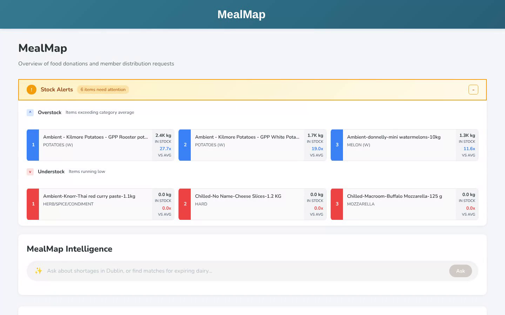
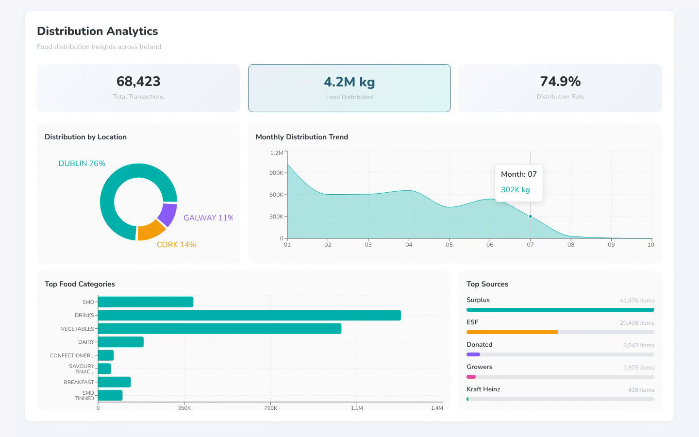
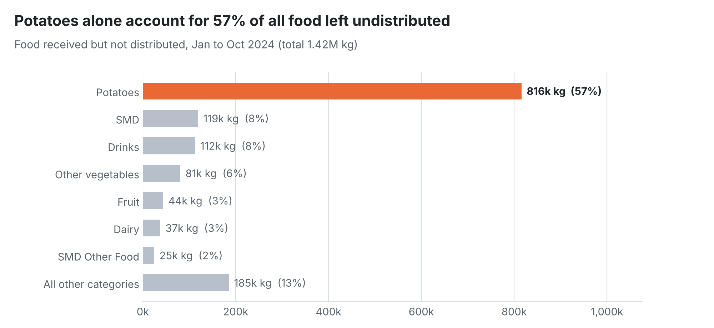
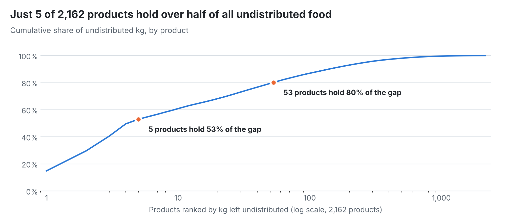
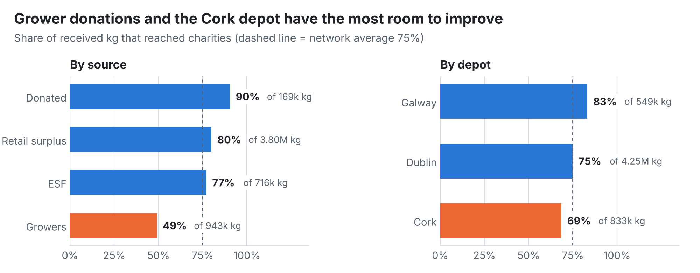
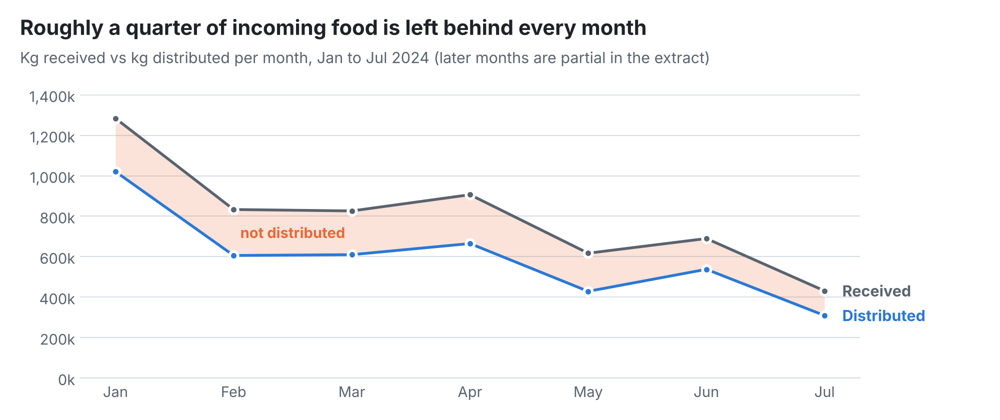
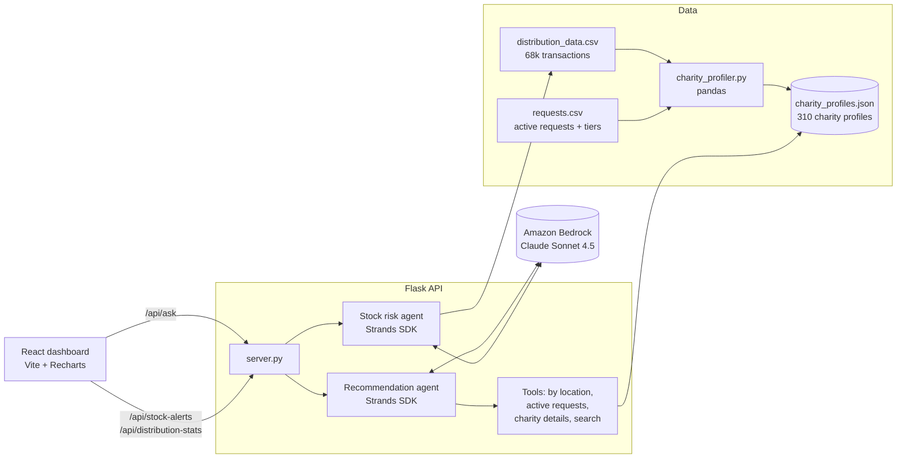

<div align="center">

# 🍎 MealMap

### Agentic AI for smarter surplus food distribution across Ireland

Built at the **AWS Breaking Barriers Hackathon** for the **FoodCloud** challenge


[**▶ Watch the demo**](#-demo) · [**Data insights**](#-data-insights-and-impact) · [**How it works**](#-how-it-works) · [**Run it locally**](#-run-it-locally)

</div>

---

## 🎬 Demo

<!--
  FULL VIDEO: on github.com, click the pencil icon to edit this README,
  then drag docs/mealmap-demo.mp4 onto the line below. GitHub uploads it and
  inserts a https://github.com/user-attachments/assets/... link, which plays
  as an inline video player. Delete this comment afterwards.
-->

<p align="center">
  
</p>

| Stock alerts | Distribution analytics |
|---|---|
|  |  |

---

## 💡 The problem

FoodCloud redistributes surplus food from supermarkets and growers to hundreds of charities across Ireland. Deciding **which charity should receive which donation** is largely manual: coordinators juggle stock that is close to expiry, warehouses that are overstocked on some lines and empty on others, and charities with very different needs, capacities and membership tiers.

Poor matches mean food goes to waste or reaches a charity that cannot use it.

## ✅ The solution

MealMap gives distribution coordinators a single dashboard plus an AI assistant that reasons over the real network:

- **Stock Alerts** flag products that are heavily overstocked against their category average (redistribute first) and lines that are running out (source more).
- **MealMap Intelligence** is a conversational agent. Ask *"We have 500 kg of tinned food in Cork, who should get it?"* and it calls tools over the charity knowledge base, then returns ranked matches with reasons. If a question is vague it asks a clarifying question instead of guessing.
- **Distribution Analytics** summarises 68,000+ historical transactions (4.2 million kg of food) by location, category, source and month.

---

## 📊 Data insights and impact

I analysed FoodCloud's distribution records to find where food is being lost and to show why an AI matching agent helps. The figures below come from **67,768 transactions** (Jan to Oct 2024) across the Dublin, Cork and Galway depots and **2,162 products**.

| 📦 Food received | 🚚 Reached charities | ⚠️ Left undistributed | 🏠 Charity network |
|:---:|:---:|:---:|:---:|
| **5.63M kg** | **4.21M kg (74.8%)** | **1.42M kg** | **310 charities** |

### 1. The problem is concentrated, not spread out

<picture>
  <source media="(prefers-color-scheme: dark)" srcset="docs/charts/undistributed-by-category-dark.png">
  
</picture>

- Vegetables are **33% of everything received** but **63% of everything left undistributed**. They reach charities at only **52%**, against **86%** for every other category combined.
- **Potatoes alone account for 816k kg, or 57% of the whole gap.** These are bulk 5 kg to 20 kg sacks arriving in large loads, while the typical charity orders around **15 kg** at a time.

<picture>
  <source media="(prefers-color-scheme: dark)" srcset="docs/charts/pareto-products-dark.png">
  
</picture>

- **5 products out of 2,162 hold over half of the undistributed food**, and 53 products hold 80%. Focusing attention on a short watch list of products would cover most of the problem, which is exactly what the **Stock Alerts** panel does.

### 2. Some sources and depots convert far better than others

<picture>
  <source media="(prefers-color-scheme: dark)" srcset="docs/charts/rate-by-source-and-depot-dark.png">
  
</picture>

- **Grower donations reach charities at 49%**, compared with 80% for retail surplus and 90% for direct donations. Grower loads are the bulk vegetable consignments above.
- **Cork distributes 69%** of what it receives, against **83% in Galway**, even though Galway handles a smaller volume.

<picture>
  <source media="(prefers-color-scheme: dark)" srcset="docs/charts/monthly-received-vs-distributed-dark.png">
  
</picture>

- The gap is **persistent rather than seasonal**: between 69% and 79% of food was distributed in every month from January to July. That points to a matching problem, not a one-off surge.

### 3. How MealMap responds, and the opportunity

| Insight | MealMap feature |
|---|---|
| Bulk loads do not fit small charities | The agent ranks matches on **order capacity**, so large consignments go to charities that can actually take them |
| A handful of products cause most of the gap | **Stock Alerts** flag products stocked far above their category average (the top alerts are potato lines) |
| Active needs are not always visible | The agent prioritises charities with an **open request** for that category, then **membership tier** |

**Sizing the opportunity** (scenario estimates from the 2024 data, not measured results):

- If vegetables reached charities at the same rate as other categories, **about 634k kg more food** would be distributed, a **15% increase** on the current total.
- If Cork matched Galway's rate, **about 123k kg more** would reach charities from Cork alone.

<sub>Analysis is reproducible: `python docs/make_charts.py` rebuilds every chart and prints these figures. About 1% of rows with malformed fields were excluded.</sub>

---

## 🧠 How it works



**1. Learn charity habits.** `charity_profiler.py` turns raw distribution logs and request sheets into a knowledge base of 310 charity profiles: location, membership tier, preferred food categories, average order size and open requests.

**2. Agentic matching.** The recommendation agent (Strands Agents SDK on Amazon Bedrock) does not have the data pasted into its prompt. It decides which tools to call (`get_charities_by_location`, `get_active_requests`, `get_charity_details`, `search_charities`) and ranks matches with a clear priority order:

1. Active request for that category
2. Membership tier (Gold > Silver > Bronze)
3. Historic preference and order capacity (no sending 1,000 kg to a charity that averages 5 kg)

**3. Multi-turn conversation.** Each response is structured JSON with a status of `complete` or `needs_clarification`, so the UI can show clickable follow-up options, a *Refine Answer* button and an expandable details panel. Session history keeps the conversation coherent.

**4. Stock risk.** A second agent and a set of pandas functions compare each product's stock against its category average to surface overstock and understock lines in real time.

---

## 🛠 Tech stack

| Layer | Tools |
|---|---|
| Frontend | React 19, Vite 7, React Router, Recharts, custom CSS design system (Nunito) |
| Backend | Python, Flask, Flask-CORS |
| AI | Amazon Bedrock (Claude Sonnet 4.5), Strands Agents SDK, tool use, structured JSON output |
| Data | pandas, CSV/JSON knowledge base |
| DevOps | GitHub Actions to GitHub Pages, AWS S3 static hosting |

---

## 👩‍💻 My role

<!-- Edit this to reflect exactly what YOU built. Recruiters read this section first. -->

- _e.g. Built the charity profiling pipeline in pandas that turns 68k raw transactions into 310 structured charity profiles_
- _e.g. Designed the agent's tool set and ranking logic on Amazon Bedrock with the Strands SDK_
- _e.g. Built the stock risk analysis (overstock / understock vs category average)_
- _e.g. Presented the solution to the FoodCloud and AWS judging panel_

**Team:** _add teammates' names and GitHub links here_

---

## 🚀 Run it locally

**Prerequisites:** Node 20+, Python 3.10+, and AWS credentials with Amazon Bedrock access (only needed for the AI assistant; the dashboard and stock alerts work without it).

```bash
# 1. Backend API (port 5001)
cd agents
python -m venv .venv && source .venv/bin/activate
pip install -r requirements.txt
python charity_profiler.py      # optional: rebuild charity_profiles.json
python server.py

# 2. Frontend (new terminal, port 5173)
cd mealmap
npm install
npm run dev
```

Open <https://wml97-l.github.io/AWS-hackathon-food-redistribution-platform/>

**Record your own demo video:** with both servers running, `python docs/record_demo.py --ask "your question"` produces a fresh screen recording using Playwright.

---

## 📁 Project structure

```
├── agents/                      # Python backend and AI agents
│   ├── server.py                # Flask API
│   ├── agent.py                 # Conversational recommendation agent
│   ├── tools.py                 # Agent tools over the charity knowledge base
│   ├── category_based_risk.py   # Overstock / understock analysis + risk agent
│   ├── charity_profiler.py      # Builds charity_profiles.json
│   └── charity_profiles.json    # Knowledge base (310 charities)
├── mealmap/                     # React + Vite frontend
│   └── src/components/          # StockAlerts, GapAnalysis (AI), DistributionAnalytics
├── docs/                        # Demo video, GIF, screenshots, insight charts + scripts
└── .github/workflows/deploy.yml # GitHub Pages deployment
```

---

## 🔭 What I would build next

- Deploy the Flask API (AWS Lambda + API Gateway) so the hosted dashboard is fully live
- Expiry-aware routing that factors in travel time between depots and charities
- Feedback loop: learn from which recommendations coordinators accept or override

---

<div align="center">
<sub>Built for FoodCloud at the AWS Breaking Barriers Hackathon. Data was provided for the hackathon and is used here for demonstration only.</sub>
</div>
